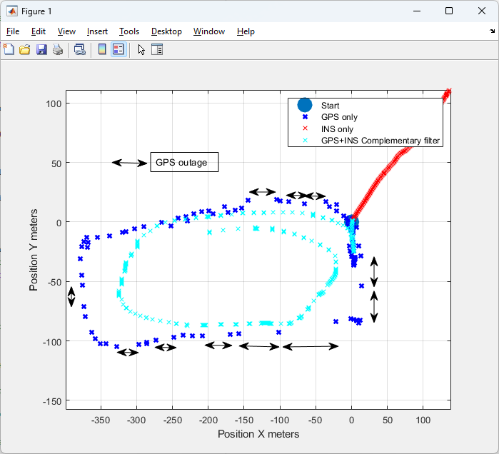
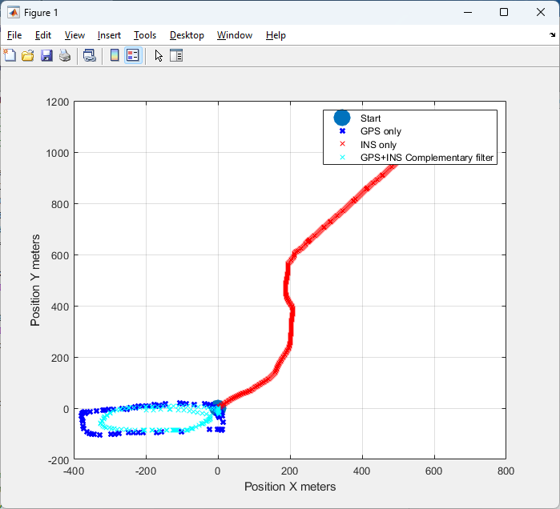

What was this project:

  Basically, in this project, I wanted to keep track of my position even when the GPS stops working, like it does when you go through a tunnel. GPS gives a position that doesn't drift, but it only updates about 1-10Hz and it can disappear. A motion sensor (the INS based on IMU gyroscopes and accelerometers, and some signal processing) updates really fast (100Hz), but the position you get from it drifts away over time due to accumulation of errors. So I tried to combine the two to get a fast, smooth position that doesn't drift too much and keeps going when the GPS is gone.

How did I build this Project:

  I started with an Arduino, an Adafruit BNO055 IMU, and a GPS module connected to pins 2 and 3, and I wrote one sketch (gpsPlusIns.ino) that does everything. First, the BNO055 gives me the acceleration with gravity already taken out, and it also tells me which way it is pointing (roll, pitch, and yaw). I use those three angles to turn the acceleration into East and North directions, and if the acceleration is smaller than 0.05 m/s^2 I just set it to zero since that is mostly noise. Then, every 20 milliseconds (so 50 times a second), I add up the acceleration to get velocity and add up the velocity to get position. That gives me a position from the IMU alone. On the GPS side, the first time the GPS gets a good fix I call that spot (0, 0), and after that I change every new latitude and longitude into meters East and North from that spot. Then, every time a new GPS fix comes in, I mix the two together with a complementary filter: the new position is 90% from the IMU and 10% from the GPS, and the new velocity is 80% from the IMU and 20% from the GPS speed and heading. That way, the IMU does most of the work in between GPS fixes, and the GPS slowly pulls the answer back so it doesn't drift off. To test what happens when the GPS goes out, I added a way to fake an outage: if I type "b" in the Serial Monitor, the code ignores the GPS for 10 seconds and only uses the IMU, and then goes back to using the GPS. The Arduino prints the GPS position, the IMU-only position, and the mixed position (in meters) 50 times a second, and I copied those numbers into MATLAB to make my plots. I also started writing a Kalman filter (MyInsGpsKalman.h) to see if it could do better, but that is still experimental.

What I found:

  In this plot I walked around a loop. The blue X's are the GPS, and the two sided arrows show where the GPS had gaps. The light blue line is my mixed estimate, and it keeps going smoothly right through the gaps, with some drift. The red line is just the IMU by itself, and it wanders off the loop.

  When I zoom out, the IMU by itself ends up more than 1,000 meters away from where I started, even though the loop I drove on is only about 400 meters wide. That shows how fast the errors grow when you add up acceleration twice. With the GPS mixed in, the estimate stays with the loop.

Challenges:

  The biggest problem is that the IMU drifts really fast, because any little error in the acceleration gets added up twice. Without the GPS, the position drifts further and further off, which is the red line in the plots. Another problem I ran into was that the velocity kept slowly creeping even when I was holding the sensor still, so I made the code slow the velocity down a little (multiplying it by 0.9) whenever the acceleration reads zero. I also first tried to turn the acceleration into East and North using only the heading angle, but that gets worse when the sensor isn't flat, so I switched to using all three angles (roll, pitch, and yaw). Even so, it still isn't perfect. The mix I use is fixed (90/10 for position and 80/20 for velocity), so it can't change if the GPS gets noisier or if I move around a lot, and that leaves some position drift. It also doesn't work as well when the sensor is moving quickly or changing direction a lot. And my way of changing latitude and longitude into meters pretends the Earth is flat, so it only works over small areas.

What I am going to Improve:

  I want to finish the Kalman filter (MyInsGpsKalman.h). Right now it is just an early try, with the acceleration noise set to 0.5 and the GPS noise set to 2.5 meters, and I haven't tuned it or compared it carefully to my complementary filter yet. The idea is that a Kalman filter can change how much it trusts the GPS or the IMU depending on how noisy things are and how the sensor is moving, instead of always using the same 90/10 mix. I also want to figure out the accelerometer's built-in offset (bias) and remove it so the drift grows more slowly, and I want to measure how far off I really am compared to a known path so I have actual error numbers instead of just plots.

What I used:

  Arduino [board], Adafruit BNO055 IMU, a GPS module [model], and these Arduino libraries: Adafruit BNO055, Adafruit Unified Sensor, TinyGPSPlus, and SoftwareSerial. I used MATLAB for the plots. To run it, upload gpsPlusIns/gpsPlusIns.ino, open the Serial Monitor at 115200 baud, take it outside so the GPS finds satellites, and walk around. Type "b" to fake a 10 second GPS outage.
